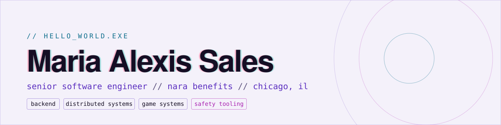

<picture>
  <source media="(prefers-color-scheme: dark)" srcset="./assets/banner-dark.svg">
  
</picture>

I'm a software engineer who likes figuring out how things work and then building something with them. Right now that's a HIPAA-regulated health benefits platform at Nara Benefits. Before that: enterprise platforms at USG, fintech at Pacific Life, and LiveOps on <em>Diablo II: Resurrected</em> at Blizzard. Off the clock I make Project Zomboid mods (a lot of them, honestly) and safety tooling for survivors of tech-facilitated abuse.

<a href="https://mariaalexissales.github.io">Portfolio</a> &nbsp;·&nbsp;
<a href="https://www.linkedin.com/in/maria-alexis-sales/">LinkedIn</a> &nbsp;·&nbsp;
<a href="https://mariaalexissales.github.io/resume/maria-sales-resume.pdf">Resume</a>

<a href="https://git.io/typing-svg">
<picture>
  <source media="(prefers-color-scheme: dark)" srcset="https://readme-typing-svg.demolab.com?font=Orbitron&pause=1200&color=B78CFF&center=true&vCenter=true&width=640&lines=Senior+Software+Engineer+%40+Nara+Benefits;Backend+%26+Distributed+Systems;Project+Zomboid+Modder;Advocate+for+Survivors+of+Tech-Facilitated+Abuse">
  
</picture>
</a>

<a href="https://git.io/streak-stats">
<picture>
  <source media="(prefers-color-scheme: dark)" srcset="https://streak-stats.demolab.com?user=mariaalexissales&theme=shadow-purple&background=0A0711&ring=B78CFF&fire=E85FFF&currStreakLabel=B78CFF&hide_border=true">
  
</picture>
</a>

## Now

**Senior Software Engineer** at **Nara Benefits**, Oct 2026 to now

- Spanish support end to end across the member portal: a translation review flow in the CRM, members' language saved on the server, and carried into emails, SMS, EOBs and the AI chat assistant
- Vendor claims and payments intake on SFTP connectors, Temporal schedules and an append-only ledger in PostgreSQL, with an alarm on every feed
- Hardening: secrets and member contact details out of the logs, query strings redacted from WAF logs, dependency advisories cleared across the monorepo

Also at **Snorkel AI** since 2024, reviewing coding-agent benchmark tasks built from real open-source PRs.

## Before that

| Where | What I did | When |
|---|---|---|
| **USG** | NestJS backend for the redesigned USG site. Fixed Kafka messages blowing the 2GB limit and traced PostgreSQL → Kafka → Algolia in Datadog | 2025–26 |
| **Pacific Life** | C# event-ingestion API onto Kafka; MuleSoft integrations moved to Lambda across three regions | 2024 |
| **Blizzard** | LiveOps tooling for *Diablo II: Resurrected*: console crash reports routed per platform, and a build step that killed environment drift | 2022–24 |
## Building

| | |
|---|---|
| [**Quietroom**](https://github.com/mariaalexissales/Quietroom) | Looks like a pomodoro timer. Underneath, it's survivor resources built around the HARMS threat model. Proof of concept, not wired to real services |
| [**go-ledger**](https://github.com/mariaalexissales/Go-Ledger) | Double-entry ledger API in Go with a live security console. One demo spoofs `X-Forwarded-For`. Toggle the fix off and watch it get through · [try it](https://mariaalexissales.github.io/Go-Ledger/) |
| [**Cooking Companion**](https://github.com/mariaalexissales/cooking-companion) | Local-first pantry PWA for the "do we already have this?" moment in the supermarket aisle · [try it](https://mariaalexissales.github.io/cooking-companion/) |

### Project Zomboid mods (B42)

| | |
|---|---|
| [**LAPLACE//DAEMON**](https://steamcommunity.com/sharedfiles/filedetails/?id=3809376465) | Server-authoritative item RPG: forged blades roll rarity, tarot cards socket in. Clients never send outcomes |
| [**Dead Court Deck**](https://steamcommunity.com/sharedfiles/filedetails/?id=3800241753) | 352-card collectible economy with admin-defined rewards in one JSON file |
| [**Quest System Framework**](https://steamcommunity.com/sharedfiles/filedetails/?id=3794717412) | Quests for MP servers, made with RP servers in mind. No restart needed |
| [**Player Leaderboard System**](https://steamcommunity.com/sharedfiles/filedetails/?id=3795596462) | Kill and death boards that are hard to farm |
| [**Remove Vanilla Anything**](https://steamcommunity.com/sharedfiles/filedetails/?id=3799346338) | 66 toggles to pull vanilla loot and vehicles out of the spawn tables |
| [**Bundle Up!**](https://steamcommunity.com/sharedfiles/filedetails/?id=3746632343) | Pack loose inventory into carryable bundles, now with a packing UI |
| [**Pinoy Pantry**](https://steamcommunity.com/sharedfiles/filedetails/?id=3791631305) | Filipino pantry staples in Knox County. More coming! |

## Stack

**Languages** &nbsp;

**Backend** &nbsp;

**Cloud** &nbsp;

**Frontend** &nbsp;

**Games** &nbsp;

## Say hi

Running a PZ server and want something built, or just wanna talk backend stuff? Find me on [LinkedIn](https://www.linkedin.com/in/maria-alexis-sales/) or drop a comment on any of the Workshop pages :D
